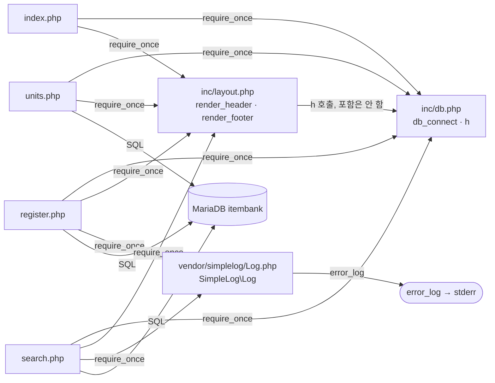

# item-bank-php 아키텍처

> 대상: `legacy/item-bank-php/` (읽기 전용 분석 결과, 진입점 · 의존 관계 단계까지)

## 1. 모듈 개요

- PHP 7.4 + Apache 로 도는 문항 은행 화면이다(`Dockerfile:1`). 코드를 `/var/www/html/` 로 복사하고(`Dockerfile:13`) 호스트 8081 로 연다(`docker-compose.yml:39`).
- 라우터 · 프레임워크 없이 PHP 파일 하나가 URL 하나다. 모듈 루트 · `inc/` · `vendor/simplelog/` 에 `.htaccess` 는 없다.
- 화면은 홈 · 단원 목록 · 문항 등록 · 문항 검색 4개이고, 공통 코드는 `inc/db.php`(DB 연결 · `h()`), `inc/layout.php`(머리말 · 꼬리말), `vendor/simplelog/Log.php`(로그) 3개다.
- DB 는 mysqli 로 MariaDB `itembank` 에 붙는다(`inc/db.php:14-21`, `docker-compose.yml:41-46`). SQL 이 화면 파일 안에 직접 들어 있다.
- 코드의 약 절반이 `search.php` 의 `buildSearchQuery` 한 함수(523줄)에 몰려 있다(`search.php:42-564`).

## 2. 폴더 구조

```
legacy/item-bank-php/
├── Dockerfile              php:7.4-apache, mysqli, display_errors=Off, error_log → stderr
├── index.php        (14)   홈 메뉴
├── units.php        (48)   단원 목록 (절차형 스크립트)
├── register.php    (177)   문항 등록 (절차형 스크립트)
├── search.php      (731)   문항 검색 (함수 4개 + 메인 흐름)
├── inc/
│   ├── db.php       (37)   db_connect(), h()
│   └── layout.php   (43)   render_header(), render_footer()
└── vendor/
    └── simplelog/
        └── Log.php  (54)   SimpleLog\Log (error_log 래퍼)
```

괄호 안은 줄 수.

## 3. 진입점

| URL / 화면 이름 | 처음 실행되는 파일 | 부르는 주요 함수 (순서대로) |
|---|---|---|
| `/` 또는 `/index.php` / 홈 메뉴 | `index.php` | `render_header('홈')` `index.php:5` → `render_footer()` `index.php:14` |
| `/units.php` / 단원 목록 | `units.php` | `render_header` `units.php:5` → `db_connect` `units.php:8` → `$conn->query` `units.php:20` → `h` `units.php:40-43` → `render_footer` `units.php:48` |
| `/register.php` (GET 폼 · POST 등록) / 문항 등록 | `register.php` | `db_connect` `register.php:17` → `$conn->query`(단원 · 태그 목록) `register.php:27,34` → (POST) `begin_transaction` `:85` · `query` `:87` · `prepare`/`execute` `:92-99,105-108` · `commit` `:114` · `Log::info` `:115` / 실패 시 `rollback` `:120` · `Log::error` `:121` → `render_header` `:127` → `render_footer` `:177` |
| `/search.php?q=&unit=&level=&tag=&sort=&dir=&page=` / 문항 검색 | `search.php` | `Log::setThreshold` `search.php:27` → `render_header` `:709` → `db_connect` `:713` → `buildSearchQuery($_GET, $conn)` `:722` → `renderSearchForm` `:723` → `runSearchQuery` `:724` → `renderResultTable` `:725` → 실패 시 `Log::error` `:727` → `render_footer` `:731` |

- 메뉴에 걸린 진입점은 `search` · `register` · `units` 3개다(`inc/layout.php:9-13`). `index.php` 는 로고 링크로 들어간다(`inc/layout.php:30`).
- `register.php` · `units.php` 는 함수 없이 위에서 아래로 실행되는 절차형 스크립트다. `register.php` 의 POST 처리부(`register.php:40-125`, 86줄)가 검증 · 트랜잭션 · 로그를 한곳에서 한다.

## 4. 의존 관계

### 4.1 흐름도

`A --> B` 는 "A 가 B 를 포함하거나 호출한다"는 뜻이다.



### 4.2 파일 포함 (require_once)

| A → B | 근거 |
|---|---|
| `index.php` → `inc/db.php` | `index.php:2` |
| `index.php` → `inc/layout.php` | `index.php:3` |
| `units.php` → `inc/db.php` | `units.php:2` |
| `units.php` → `inc/layout.php` | `units.php:3` |
| `register.php` → `inc/db.php` | `register.php:2` |
| `register.php` → `inc/layout.php` | `register.php:3` |
| `register.php` → `vendor/simplelog/Log.php` | `register.php:4` (`use SimpleLog\Log` `:6`) |
| `search.php` → `inc/db.php` | `search.php:20` |
| `search.php` → `inc/layout.php` | `search.php:21` |
| `search.php` → `vendor/simplelog/Log.php` | `search.php:22` (`use` `:24`) |

페이지끼리는 서로 포함하지 않는다. 화면 사이 연결은 HTML 링크뿐이다(`index.php:9-11`, `inc/layout.php:9-13`).

### 4.3 함수 호출 (파일 경계를 넘는 것)

| A → B (A 가 B 를 호출) | 근거 | 비고 |
|---|---|---|
| `index.php` · `units.php` · `register.php` · `search.php` → `render_header` · `render_footer` (`inc/layout.php`) | `index.php:5,14`, `units.php:5,48`, `register.php:127,177`, `search.php:709,731` | |
| `units.php` → `db_connect` (`inc/db.php`) | `units.php:8` | |
| `register.php` → `db_connect` | `register.php:17` | |
| `search.php` → `db_connect` | `search.php:713` | |
| `index.php` → `db_connect` | 없음 | `db.php` 를 포함만 하고 `db_connect` 는 부르지 않는다(`index.php:1-14`) |
| `inc/layout.php` → `h` (`inc/db.php`) | `inc/layout.php:17,33` | `layout.php` 는 `db.php` 를 포함하지 않는다. 모든 페이지가 `db.php` 를 먼저 포함해서 동작하는 숨은 순서 의존(`index.php:2-3` 등) |
| `register.php` → `Log::info` · `Log::error` | `register.php:115,121` | |
| `search.php` → `Log::setThreshold` · `Log::debug` · `Log::error` | `search.php:27,103,528,537,727` | |
| `vendor/simplelog/Log.php` → `error_log` (PHP 내장) | `Log.php:52` | 출력은 stderr(`Dockerfile:10`) |

### 4.4 search.php 내부 호출

| A → B | 근거 |
|---|---|
| 메인 흐름 → `buildSearchQuery` · `renderSearchForm` · `runSearchQuery` · `renderResultTable` | `search.php:722-725` |
| `buildSearchQuery` → `h` · `Log::debug` · `Log::error` · `$conn->prepare` / `query` | `search.php:125,156,178,360,528,537` |
| `runSearchQuery` → `$conn->prepare($built['count_sql'])` · `$conn->prepare($built['sql'])` | `search.php:577,600` |
| `renderSearchForm` · `renderResultTable` → (DB 없음) `$built` 배열만 읽음 | `search.php:631,652-653,662` |

### 4.5 DB 의존

| 파일 | 대상 | 근거 |
|---|---|---|
| `inc/db.php` | 환경변수 `DB_*`, 없으면 `app`/`app-pass` @ `mariadb:3306/itembank` | `inc/db.php:14-18`, `docker-compose.yml:41-46` |
| `units.php` | `unit`, `item`(`status='A'`) | `units.php:16-19` |
| `register.php` | 읽기 `unit` · `tag`, 쓰기 `item` · `item_tag` | `register.php:27,34,87,93,105` |
| `search.php` | `unit`, `tag`, 뷰 `v_item_public`, `item_tag` | `search.php:125,156,178,244-245,522` |

## 5. 가장 긴 함수 3개

| 순위 | 파일 | 함수 | 시작 – 끝 | 줄 수 | 하는 일 |
|---|---|---|---|---|---|
| 1 | `search.php` | `buildSearchQuery` | `search.php:42` – `search.php:564` | 523 | GET 파라미터를 검증해 WHERE · ORDER BY · LIMIT SQL 과 바인딩을 조립하고, 단원 · 태그 목록 조회와 폼 · 요약 · 경고 · 정렬링크 HTML 생성까지 한다 |
| 2 | `search.php` | `renderResultTable` | `search.php:647` – `search.php:704` | 58 | 건수 · 결과 표(id · title · unit · level · tags) · 페이지 링크를 출력한다. 0건이면 "검색 결과가 없습니다" |
| 3 | `search.php` | `runSearchQuery` | `search.php:571` – `search.php:624` | 54 | 건수 SQL 과 목록 SQL 을 prepare · 바인딩 · 실행해 `{total, rows}` 를 돌려준다 |

- 그 밖의 함수는 모두 30줄 이하다: `render_header` 30줄(`inc/layout.php:7-36`), `db_connect` 23줄(`inc/db.php:7-29`), `renderSearchForm` 13줄(`search.php:629-641`), `Log` 메서드 12줄 이하(`Log.php:18-53`).
- `buildSearchQuery` 는 이름과 달리 DB 조회 2~3회(`search.php:125,156,178`)와 HTML 생성(`search.php:354-516`)을 함께 한다.

## 6. 미확인 목록

| 항목 | 상태 · 확인 방법 |
|---|---|
| 뷰 `v_item_public` 의 정의(어떤 조건으로 "공개"를 거르는지) | 미확인. `db/mariadb/init/` 를 읽어야 한다 |
| 테이블 `unit` · `item` · `tag` · `item_tag` 의 스키마 · 컬럼 의미 | 미확인. `db/mariadb/init/` |
| `inc/*.php` · `vendor/.../Log.php` 를 URL 로 직접 열 수 있는지 | 미확인. `.htaccess` 는 없지만 Apache 기본 설정은 직접 확인하지 않았다 |
| 난이도를 비웠을 때 `level < 5` 조건이 붙는 것이 의도인지 | 미확인. 주석은 "1~5 모두 포함"인데 코드는 난이도 5 를 뺀다(`search.php:213-215`) |
| 등록 직후 `status='R'`(검수중) 문항이 `A` 로 바뀌는 경로 | 미확인. 이 모듈의 코드에는 없다(`register.php:84,94`, `units.php:15-17`) |
| 데이터 흐름 · 비즈니스 규칙 단계 | 미분석 |
