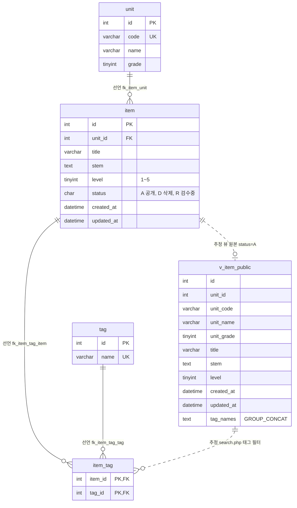

# item-bank-php 데이터 흐름 · ERD

> 대상: `legacy/item-bank-php/` (읽기 전용 분석). 선행 문서: [ARCHITECTURE.md](ARCHITECTURE.md)
> 근거는 저장소 파일의 `파일:줄번호` 다. 실행 중인 DB 에 접속해 확인하지 않았다.

## 0. 요약

- 이 모듈이 쓰는 DB 객체는 테이블 4개(`unit` · `item` · `tag` · `item_tag`)와 뷰 1개(`v_item_public`)다.
- 쓰기는 `register.php` 한 곳뿐이고, `item` · `item_tag` 에 INSERT 만 한다. 이 모듈 코드에는 UPDATE · DELETE 가 없다.
- 검색(`search.php`)은 테이블 `item` 을 직접 읽지 않고 뷰 `v_item_public`(`status = 'A'` 만)을 읽는다. 단원 목록(`units.php`)은 `item` 을 직접 읽고 `status = 'A'` 를 코드에서 건다.
- 코드의 JOIN · 서브쿼리는 모두 선언된 외래 키를 따라간다. 외래 키 없이 코드에서만 생기는 관계는 뷰 `v_item_public` 을 끼는 2개뿐이다.

## 1. 테이블 목록

| 테이블 | 주요 컬럼 | 근거 |
|---|---|---|
| `unit` (단원) | `id` INT PK · `code` VARCHAR(16) UNIQUE(`uk_unit_code`) · `name` VARCHAR(100) · `grade` TINYINT | `db/mariadb/init/01-schema.sql:11-18` |
| `item` (문항) | `id` INT PK(자동 증가 아님) · `unit_id` INT FK → `unit.id` · `title` VARCHAR(200) · `stem` TEXT · `level` TINYINT(1~5) · `status` CHAR(1) 기본 `'A'` (A=공개 D=삭제 R=검수중) · `created_at` DATETIME · `updated_at` DATETIME. 인덱스 `idx_item_unit`, `idx_item_level` | `01-schema.sql:20-33` (level 주석 `:25`, status 주석 `:26`) |
| `tag` (태그) | `id` INT PK · `name` VARCHAR(50) UNIQUE(`uk_tag_name`) | `01-schema.sql:35-40` |
| `item_tag` (문항 ↔ 태그) | `item_id` INT FK → `item.id` · `tag_id` INT FK → `tag.id` · PK(`item_id`, `tag_id`) | `01-schema.sql:42-48` |
| `v_item_public` (뷰, 테이블 아님) | `id` · `unit_id` · `unit_code` · `unit_name` · `unit_grade` · `title` · `stem` · `level` · `created_at` · `updated_at` · `tag_names`(태그 이름을 `t.id` 순으로 `,` 로 이은 문자열). 조건 `item.status = 'A'`, `item JOIN unit` | `01-schema.sql:52-70` |

참고

- `unit.grade` 를 "학년"으로 읽는 근거는 스키마 주석이 아니라 화면 문구다(`units.php:36` 머리글 "학년", `search.php:133` `'학년'`).
- `item.id` 는 AUTO_INCREMENT 가 아니다(`01-schema.sql:21`). 등록 화면이 `MAX(id) + 1` 을 `FOR UPDATE` 로 잡아 채번한다(`register.php:87`).
- 같은 스키마 파일의 `class` · `assignment` · `distribution` · `submission`(`01-schema.sql:75-115`)은 `assignment-thymeleaf` 모듈용이고(`01-schema.sql:73`), 이 모듈 코드는 참조하지 않는다. 다만 `assignment.unit_id` 가 `unit.id` 를 외래 키로 참조한다(`01-schema.sql:89`) — `unit` 을 바꿀 때 영향 범위에 들어간다.

## 2. 테이블 관계

실선(`--`)은 외래 키로 **선언**된 관계, 점선(`..`)은 선언 없이 뷰 정의 · 코드에서 **추정**한 관계다.

| 관계 | 구분 | 근거 (선언) | 코드에서 쓰는 곳 |
|---|---|---|---|
| `unit` 1 — N `item` (`item.unit_id` → `unit.id`) | 선언 | `01-schema.sql:32` | `units.php:17` (`i.unit_id = u.id` 서브쿼리), 뷰 `01-schema.sql:69` (`JOIN unit u ON u.id = i.unit_id`) |
| `item` 1 — N `item_tag` (`item_tag.item_id` → `item.id`) | 선언 | `01-schema.sql:46` | 뷰 `01-schema.sql:67`, `register.php:105` (INSERT) |
| `tag` 1 — N `item_tag` (`item_tag.tag_id` → `tag.id`) | 선언 | `01-schema.sql:47` | 뷰 `01-schema.sql:66`, `search.php:244` (`JOIN tag t ON t.id = it.tag_id`), `register.php:105` |
| `item` 1 — 0..1 `v_item_public` (`v_item_public.id` = `item.id`) | 추정 | 외래 키 아님. 뷰 정의 `01-schema.sql:54,68,70` 에서 추정 | `search.php:522` (`FROM v_item_public`) |
| `v_item_public` 1 — N `item_tag` (`item_tag.item_id` = `v_item_public.id`) | 추정 | 외래 키 아님(뷰에는 FK 를 걸 수 없다) | `search.php:245` (`WHERE it.item_id = v_item_public.id`) |

- `item` : `tag` 는 `item_tag` 를 거친 N : M 이다.
- 카디널리티 중 "단원에 문항이 0개일 수 있음(`o{`)"은 스키마상 막는 제약이 없다는 뜻이다. 실제 데이터 분포는 확인하지 않았다.

## 3. 읽기 · 쓰기 위치

`register.php` · `units.php` 는 함수가 없는 절차형 스크립트라 "함수" 칸에 `(최상위)` 로 적는다.

### 3.1 테이블별

| 테이블 | 읽기 (SELECT) — 파일 · 함수 · 줄 | 쓰기 (INSERT · UPDATE · DELETE) — 파일 · 함수 · 줄 |
|---|---|---|
| `unit` | `units.php` (최상위) `:16-20` — 전 단원 + 단원별 공개 문항 수 `register.php` (최상위) `:27` — 단원 선택 목록(`id, code, name`) `search.php` `buildSearchQuery` `:125` — 코드로 단원 이름 · 학년 조회(`WHERE code = ?`) `search.php` `buildSearchQuery` `:156` — 단원 선택 목록(`code, name, grade`) (간접) 뷰 `v_item_public` 경유 → `search.php` `runSearchQuery` `:577,600` | 없음 |
| `item` | `units.php` (최상위) `:17` — `COUNT(*) ... WHERE status = 'A'` `register.php` (최상위) `:87` — `MAX(id)` 채번(`FOR UPDATE`, 트랜잭션 안 `:85`) (간접) 뷰 `v_item_public` 경유 → `search.php` `runSearchQuery` `:577,600` | INSERT `register.php` (최상위) `:93-99` — `status` 는 리터럴 `'R'`, `created_at` · `updated_at` 는 `NOW()`(`:94`) UPDATE · DELETE 없음 |
| `tag` | `register.php` (최상위) `:34` — 태그 체크박스 목록(`id, name`) `search.php` `buildSearchQuery` `:178` — 태그 선택 목록(`name`) `search.php` `buildSearchQuery` 가 조립 · `runSearchQuery` 가 실행 `:244-245` → `:577,600` — 태그 이름 필터 `EXISTS` (간접) 뷰의 `tag_names` | 없음 |
| `item_tag` | `search.php` `buildSearchQuery` 조립 `:244-245`, `runSearchQuery` 실행 `:577,600` — 태그 필터 `EXISTS` (간접) 뷰의 `tag_names` 서브쿼리(`01-schema.sql:64-67`) | INSERT `register.php` (최상위) `:105-111` — 체크한 태그마다 1행, `item` INSERT 와 같은 트랜잭션(`:85` ~ `:114`) UPDATE · DELETE 없음 |
| `v_item_public` (뷰) | `search.php` `buildSearchQuery` 가 SQL 조립 `:521-526`(목록 `id, title, unit_code, level, tag_names, created_at` + 건수 `COUNT(*)`), `runSearchQuery` 가 실행 `:577`(건수) · `:600`(목록) | 해당 없음(뷰) |

- `search.php` 의 메인 흐름은 `buildSearchQuery`(`:722`) → `runSearchQuery`(`:724`) 순서다. `buildSearchQuery` 는 이름과 달리 `unit` · `tag` 를 직접 조회한다(`:125,156,178`).
- 뷰에서 `search.php` 가 쓰는 컬럼은 `id, title, unit_code, level, tag_names, created_at`(`:521`)과 WHERE 의 `title, stem, unit_code, level`(`:98,118,215-226`)이다. `unit_id` · `unit_name` · `unit_grade` · `updated_at` 은 이 모듈에서 읽지 않는다.

### 3.2 화면별 데이터 흐름

| 화면 | 흐름 |
|---|---|
| 단원 목록 `units.php` | `unit` 전체 + 단원별 `item(status='A')` 개수 → 표 출력(`units.php:16-46`) |
| 문항 등록 `register.php` (GET) | `unit` · `tag` 목록 읽기(`:27,34`) → 폼 출력 |
| 문항 등록 `register.php` (POST) | `unit` · `tag` 목록 읽기 → 입력 검증(단원 · 태그는 방금 읽은 목록과 대조 `:60-81`) → 트랜잭션 시작 `:85` → `item` `MAX(id)+1 FOR UPDATE` `:87` → `item` INSERT(`status='R'`) `:93` → `item_tag` INSERT `:105` → commit `:114` / 실패 시 rollback `:120` |
| 문항 검색 `search.php` | `unit`(코드 확인 · 목록) · `tag`(목록) 읽기 → WHERE 조립 → `v_item_public` 건수 · 목록 조회(태그 필터는 `item_tag` + `tag` `EXISTS`) → 표 출력 |

결과적으로 등록한 문항(`status='R'`)은 검색(`v_item_public`, `status='A'`)과 단원 목록의 개수(`status='A'`)에 모두 나오지 않는다(`register.php:84`의 주석과 일치).

## 4. 미확인 · 불일치

| 항목 | 상태 · 확인 방법 |
|---|---|
| `item.status` 가 `R` → `A`, 또는 → `D` 로 바뀌는 경로 | 미확인. 이 모듈에는 UPDATE 가 없다(`grep` 결과 `register.php:87` 의 `FOR UPDATE` 한 건뿐). 다른 모듈 · 운영 절차는 보지 않았다 |
| `unit` · `tag` 에 행이 추가되는 경로 | 미확인. 이 모듈에는 쓰기가 없고 시드(`db/mariadb/init/02-seed.sql`)로만 들어온다. 다른 모듈은 보지 않았다 |
| `item_tag` 행 삭제 · 태그 변경 경로 | 미확인. 이 모듈에는 없다 |
| 스키마 주석과 코드의 불일치 | `01-schema.sql:51` 은 "등록 화면이 이 뷰를 기준으로 삼는다"고 하지만 `register.php` 는 `v_item_public` 을 참조하지 않는다(`unit` · `tag` · `item` · `item_tag` 만 사용). 주석이 낡은 것인지 다른 등록 화면을 가리키는지 미확인 |
| `unit.grade` 의 값 범위 · 의미 | "학년"은 화면 문구로 추정(1장 참고). 스키마에는 주석 · 제약이 없다 |
| `item.level` 1~5 를 DB 가 강제하는지 | 스키마에는 주석만 있고 CHECK 제약이 없다(`01-schema.sql:25`). 등록 화면만 검증한다(`register.php:70`) |
| `item.status` 값이 A · D · R 로 제한되는지 | 스키마에는 주석만 있고 CHECK 제약이 없다(`01-schema.sql:26`) |
| 운영 DB 스키마가 `01-schema.sql` 과 같은지 | 미확인. 저장소의 초기화 스크립트만 읽었다 |
| `MAX(id)+1 FOR UPDATE` 채번의 동시 등록 안전성 | 미확인. 격리 수준 · 락 범위를 실제로 시험하지 않았다(`register.php:87`) |
